# 🚀 VibeForge — Application Architect & Documentor Skills

A comprehensive suite of **8 AI Skills** powered by **VibeForge** (`vibeforge`), designed to architect, research, and specify **Mobile, Web, and Desktop** applications using a structured, research-backed **Vibe Coding** methodology.

Before the AI writes a single line of production code, this skill ecosystem guides you through **Socratic business validation (BRD)**, **product & human-interaction design (PRD)**, **technical architecture & database ERD (TSD)**, **UX & design system tokens (UX & DESIGN)**, **role-based access control (RBAC)**, **reusable-first granular module blueprints (MODULS)**, and **end-to-end requirements traceability (RTM)**.

> **📄 100% Markdown Output**: Every generated document across all phases—including deep internet research reports, Mermaid architecture/ERD diagrams, OpenAPI YAML contracts, and test specifications—is saved strictly in **Markdown (`.md`)** format. This makes every blueprint both human-readable and immediately consumable as high-precision context for AI code generation.

---

## ✨ Key Features & Capabilities

1. **Multi-Persona Impersonation Across Phases**:
   The AI dynamically switches its expert persona at each phase of the lifecycle:
   - **Phase 1 — BRD (`vibe-brd`)**: *Socratic Business Challenger* — constantly questions assumptions and provides constructive **antithesis** until the true business goal is crystal clear.
   - **Phase 2 — PRD (`vibe-prd`)**: *Senior Product Manager* — probes into granular features, human-product interaction (HCI), edge cases, and security/privacy levels.
   - **Phase 3 — TSD (`vibe-tsd`)**: *Senior Developer / Principal Architect* — provides proactive technology recommendations, exposes technical bottlenecks/risks, evaluates *framework vs. no-framework* options, and generates complete **Mermaid** diagrams (Infrastructure, Software Architecture, Sequence Flows, and full Database **ERD**).
   - **Phase 4 — UX & Design (`vibe-ux`)**: *Lead Product Designer* — analyzes visual references (images/URLs from the internet), researches UI framework/theme best practices, and defines color palettes, typography, and iconography.
   - **Phase 5 — RBAC (`vibe-rbac`)**: *Security & IAM Architect* — defines role hierarchies, user groups, CRUD/action permission matrices, and row-level data isolation policies.
   - **Phase 6 — Modules (`vibe-moduls`)**: *Lead Modular Systems Architect* — enforces **reusable code first** (`00-shared/reusable-spec.md`) and breaks down each feature module into `spec.md`, `openapi.md`, and `testing.md`.
   - **Phase 7 — RTM (`vibe-rtm`)**: *Lead QA & Governance Specialist* — audits 100% traceability from business objectives down to code files, API endpoints, and test cases.

2. **Flexible Interview Pacing (Step-by-Step vs. All-at-Once)**:
   At the start of every phase, the AI asks how you prefer to conduct the Q&A session:
   - **Step-by-Step (Iterative)**: 1–3 focused questions per turn, adapting dynamically to each previous answer.
   - **All-at-Once (Batch)**: All comprehensive discovery questions presented in a single turn for rapid completion.

3. **Multiple-Choice + 1 Custom Answer Format**:
   Every discovery question across all phases is presented as **curated multiple-choice options + 1 custom answer option**, eliminating blank-page fatigue while preserving complete flexibility.

4. **Integrated Internet Deep Research (`docs/RESEARCH/*.md`)**:
   - **BRD (Post-Interview Research)**: After completing the BRD interview, the AI offers to conduct deep internet research for **supporting references** (market trends, industry data, regulations) and **comparative references** (competitor matrix & differentiation gaps), saved to `docs/RESEARCH/brd-market-research.md`.
   - **PRD (Pre-Session Research)**: Before starting the PRD Q&A, the AI offers to research **domain PRD standards, feature benchmarks, and real-world case studies** on the internet, saved to `docs/RESEARCH/prd-feature-casestudy.md`.
   - **TSD (Pre-Session Research)**: Before starting the TSD Q&A, the AI offers to research **candidate technologies, performance benchmarks, framework vs. no-framework trade-offs, and known technical issues**, saved to `docs/RESEARCH/tsd-tech-recommendations.md`.
   - **UX (Pre-Session Research)**: Before starting the UX Q&A, the AI offers to research **best practices for frontend UI frameworks, component libraries, and theming systems** (such as *PrimeVue, shadcn/ui, DaisyUI, Radix UI, Material Design/MUI, Tailwind CSS, Bootstrap*, etc.), saved to `docs/RESEARCH/ux-framework-best-practices.md`.

5. **Adaptive Single-Environment vs. Multi-Environment Structure**:
   - **Single-Environment Apps** (e.g., Mobile-only, Web-only, or Desktop-only): `UX.md` and `DESIGN.md` are generated side-by-side at the root of `docs/` alongside `BRD.md`, `PRD.md`, and `TSD.md`.
   - **Multi-Environment Apps** (e.g., Mobile App + Web Admin + Desktop): `UX.md` and `DESIGN.md` are automatically organized into environment-specific subfolders under `docs/ux/<environment>/`.

6. **Reusable-Code-First Architecture (`docs/MODULS/00-shared/`)**:
   Prevents code duplication (*DRY Principle*) during vibe coding by specifying shared UI wrapper components, composables/hooks, middleware, standard API response envelopes, and validators in `00-shared/reusable-spec.md` before any feature module is generated.

---

## 🎯 Benefits for Vibe Coding

| Common Vibe Coding Pitfall (Without Blueprints) | How This Skill Suite Solves It |
| :--- | :--- |
| AI immediately generates code based on flawed business assumptions | **Socratic BRD & Antithesis** challenges weak assumptions and validates market differentiation on day one |
| Half-baked features, missing edge cases, and weak security | **PRD + Case Study Research** locks down human-product interaction flows, edge states, and security tiers (`SR-xx`) |
| Wrong tech stack, over-engineering, or messy database schemas | **TSD + Tech Research** evaluates *framework vs. no-framework* trade-offs and locks down a complete Mermaid **ERD** |
| Inconsistent UI styling and CSS/component library conflicts | **UX/DESIGN + UI Framework Research** establishes semantic color tokens, typography scales, and component rules |
| AI rewrites the same logic and UI components across every feature | **MODULS (`00-shared`)** enforces strict reuse of shared components, hooks, and backend utilities |
| Unclear file structure, missing API contracts, and untested code | Every module includes an exact **Backend & Frontend file manifest**, `openapi.md`, and `testing.md` |

---

## 🔄 End-to-End Workflow Diagram

```mermaid
flowchart TD
    Start(["Start Application Idea (Mobile / Web / Desktop)"]) --> Orch["vibeforge (VibeForge Master Orchestrator)"]

    subgraph Phase1 ["1. BRD Phase (vibe-brd)"]
        B1["Select Q&A Mode (Step-by-Step vs. Batch)"] --> B2["Socratic & Antithesis Interview (Multiple-Choice + 1 Custom)"]
        B2 --> B3{"Run Post-Interview Internet Research?"}
        B3 -- "Yes" --> B4["Generate docs/RESEARCH/brd-market-research.md"]
        B3 -- "No" --> B5["Generate docs/BRD.md"]
        B4 --> B5
    end

    subgraph Phase2 ["2. PRD Phase (vibe-prd)"]
        P1{"Run Pre-Session Internet Research (PRD & Case Studies)?"} -- "Yes" --> P2["Generate docs/RESEARCH/prd-feature-casestudy.md"]
        P1 -- "No" --> P3["PM Interview: Features, Human Interaction, Security Level"]
        P2 --> P3
        P3 --> P4["Generate docs/PRD.md"]
    end

    subgraph Phase3 ["3. TSD Phase (vibe-tsd)"]
        T1{"Run Pre-Session Tech & Benchmark Research?"} -- "Yes" --> T2["Generate docs/RESEARCH/tsd-tech-recommendations.md"]
        T1 -- "No" --> T3["Tech Recommendations, Issue Analysis & Stack Q&A"]
        T2 --> T3
        T3 --> T4["Generate docs/TSD.md (Mermaid Infra, Software Arch, ERD)"]
    end

    subgraph Phase4 ["4. UX & Design Phase (vibe-ux)"]
        U1{"Run Pre-Session UI Framework & Theme Best-Practice Research?"} -- "Yes" --> U2["Generate docs/RESEARCH/ux-framework-best-practices.md"]
        U1 -- "No" --> U3["Analyze Visual References (Images/URLs) & Theme/Font/Icon Q&A"]
        U2 --> U3
        U3 --> U4{"Single-Environment or Multi-Environment?"}
        U4 -- "Single-Environment" --> U5["Generate docs/UX.md & docs/DESIGN.md"]
        U4 -- "Multi-Environment" --> U6["Generate docs/ux/<env>/UX.md & DESIGN.md"]
    end

    subgraph Phase5 ["5. RBAC Phase - Optional (vibe-rbac)"]
        R1{"Generate Dedicated RBAC Specification?"} -- "Yes" --> R2["IAM Interview & Generate docs/RBAC.md"]
    end

    subgraph Phase6 ["6. Module Generation Phase (vibe-moduls)"]
        M1["Generate docs/MODULS/00-shared/reusable-spec.md (Reusable Code)"] --> M2["Generate Each Module: spec.md, openapi.md, testing.md"]
    end

    subgraph Phase7 ["7. RTM Phase - Optional (vibe-rtm)"]
        RTM1{"Generate Requirements Traceability Matrix (RTM)?"} -- "Yes" --> RTM2["Generate docs/RTM.md (BRD -> PRD -> TSD -> UX -> MODULS -> Test)"]
    end

    Orch --> B1
    B5 --> P1
    P4 --> T1
    T4 --> U1
    U5 --> R1
    U6 --> R1
    R1 -- "Skip" --> M1
    R2 --> M1
    M2 --> RTM1
    RTM1 -- "Done" --> Done(["Ready for Module-by-Module Vibe Coding Execution!"])
    RTM2 --> Done
```



---

## 📂 Generated Directory Structure (`docs/`)

All documentation generated by this skill suite uses the **`.md` (Markdown)** extension and follows this standardized directory layout:

### A. Single-Environment Structure (e.g., Web-only, Mobile-only, or Desktop-only)
```text
project-root/
└── docs/
    ├── BRD.md                              # [Phase 1] Business Requirements Document
    ├── PRD.md                              # [Phase 2] Product Requirements Document
    ├── TSD.md                              # [Phase 3] Technical Specification Document (Mermaid Infra, Arch, ERD)
    ├── UX.md                               # [Phase 4] User Experience, Information Architecture & Wireframe Flows
    ├── DESIGN.md                           # [Phase 4] Design System, Color Tokens, Typography, Iconography & UI Rules
    ├── RBAC.md                             # [Phase 5 - Optional] Role-Based Access Control Matrix & Data Scope
    ├── RTM.md                              # [Phase 7 - Optional] Requirements Traceability Matrix
    │
    ├── RESEARCH/                           # Deep Internet Research Reports (100% Markdown)
    │   ├── brd-market-research.md          # Supporting market data & comparative competitor matrix (Post-BRD)
    │   ├── prd-feature-casestudy.md        # Domain feature standards & real-world case studies (Pre-PRD)
    │   ├── tsd-tech-recommendations.md     # Technology recommendations, benchmarks & architectural issues (Pre-TSD)
    │   └── ux-framework-best-practices.md  # Frontend UI framework & theme best practices: PrimeVue, shadcn, DaisyUI, Material, Tailwind, etc. (Pre-UX)
    │
    └── MODULS/                             # [Phase 6] Granular Module Blueprints (100% Markdown)
        ├── 00-shared/
        │   └── reusable-spec.md            # Catalog of reusable UI components, composables/hooks, middleware & helpers
        ├── 01-auth/
        │   ├── spec.md                     # Role permissions, form structure & validation, tables, UI interactions, DB tables & file manifest
        │   ├── openapi.md                  # Complete OpenAPI 3.1 (YAML) contract embedded inside a Markdown file
        │   └── testing.md                  # Unit Test, Component/UI Test, and API Integration Test specifications
        ├── 02-users/
        │   ├── spec.md
        │   ├── openapi.md
        │   └── testing.md
        └── ...
```

### B. Multi-Environment Structure (e.g., Mobile App + Web Admin + Desktop App)
When an application targets multiple client environments, `UX.md` and `DESIGN.md` are automatically separated by environment inside `docs/ux/`:
```text
project-root/
└── docs/
    ├── BRD.md
    ├── PRD.md
    ├── TSD.md
    ├── RBAC.md                             # (Optional)
    ├── RTM.md                              # (Optional)
    ├── RESEARCH/
    │   ├── brd-market-research.md
    │   ├── prd-feature-casestudy.md
    │   ├── tsd-tech-recommendations.md
    │   └── ux-framework-best-practices.md
    ├── ux/
    │   ├── mobile/
    │   │   ├── UX.md
    │   │   └── DESIGN.md
    │   ├── web/
    │   │   ├── UX.md
    │   │   └── DESIGN.md
    │   └── desktop/
    │       ├── UX.md
    │       └── DESIGN.md
    └── MODULS/
        ├── 00-shared/
        │   └── reusable-spec.md
        └── ...
```

---

## 📋 Detailed Output Specifications

### 1. `docs/RESEARCH/*.md` (Internet Research Reports)
| File Name | Trigger Timing | Contents |
| :--- | :--- | :--- |
| `brd-market-research.md` | Offered **after** the BRD Q&A interview finishes | Supporting industry trends, market statistics, regulatory context, and a side-by-side comparative matrix of direct/indirect competitors with differentiation opportunities. |
| `prd-feature-casestudy.md` | Offered **before** the PRD Q&A session begins | Real-world product case studies, essential vs. differentiating features, common UX edge cases, and domain security/privacy expectations. |
| `tsd-tech-recommendations.md` | Offered **before** the TSD Q&A session begins | Candidate tech stack comparison matrix, *framework vs. no-framework* trade-off analysis, common scaling/concurrency pitfalls, and engineering mitigations. |
| `ux-framework-best-practices.md` | Offered **before** the UX Q&A session begins | Deep research on frontend UI frameworks & theming ecosystems (*PrimeVue, shadcn/ui, DaisyUI, Radix, Material UI, Tailwind CSS, Bootstrap*, etc.), CSS token architecture, accessibility standards, and curated color/font pairings. |

### 2. Core Blueprint Documents (`docs/BRD.md`, `PRD.md`, `TSD.md`, `UX.md`, `DESIGN.md`, `RBAC.md`, `RTM.md`)
- **`docs/BRD.md`**: Executive summary (Thesis, Antithesis, Synthesis), measurable business KPIs (`BO-xx`), platform strategy, stakeholder personas, *In-Scope MVP vs. Out-of-Scope*, business requirements catalog (`BR-xx`), risk matrix, and As-Is/To-Be Mermaid process flowcharts.
- **`docs/PRD.md`**: BRD alignment matrix, user stories & acceptance criteria (`FR-xx`), human-product interaction specifications (HCI ergonomics, loading/empty/error states, Mermaid user flows), and security/privacy requirements (`SR-xx`).
- **`docs/TSD.md`**: Technology stack decisions (*framework vs. no-framework* justification), technical issue mitigations, **Mermaid Infrastructure Diagram**, **Mermaid Software Architecture Diagram**, **Mermaid Sequence Diagrams**, and a complete **Mermaid Database ERD (`erDiagram`)** with data dictionary and indexing/caching rules.
- **`docs/UX.md` & `docs/DESIGN.md`**: Mermaid information architecture sitemap, navigation shell rules, screen-by-screen wireframe flows, semantic color tokens (Light/Dark HEX), typography scale, iconography rules, and component anatomy mapped to the chosen UI library.
- **`docs/RBAC.md` *(Optional)***: JWT/Middleware authorization flow, Role & User Group catalog (`ROLE-xx`), granular CRUD & custom action permission matrix, row-level/multi-tenant data isolation rules, and RBAC database schema ERD.
- **`docs/RTM.md` *(Optional)***: End-to-end traceability table mapping `BRD` → `PRD` → `TSD` → `UX` → `RBAC` → `MODULS` → `Test Cases`, coverage metrics, orphan requirement detection, and recommended build order.

### 3. `docs/MODULS/` (Granular Module Blueprints)
Every feature module folder (`docs/MODULS/<XX-module-name>/`) contains 3 Markdown files:
1. **`spec.md`**:
   - **Module Permissions by User/Group**: Role-by-role access matrix and data visibility scope.
   - **Detailed Form Structure, Input Rules & Data Tables**: Every form input field, data type, validation rule, error message, and table column/filter/action configuration.
   - **User-Interface Interaction Flow**: Step-by-step lifecycle (loading, empty state, validation feedback, confirmation modals, toast notifications) with a Mermaid state/sequence diagram.
   - **Database Tables & Queries Used**: Primary/foreign tables, columns read/written, and cache invalidation rules.
   - **File Count & Complete File Manifest**: Exact count and table of all **Backend and Frontend files** to be generated, their relative paths, responsibilities, and which assets from `00-shared/reusable-spec.md` they reuse.
2. **`openapi.md`**:
   - Endpoint summary table and authentication requirements.
   - Full **OpenAPI 3.0.3 / 3.1.0 YAML specification** inside a Markdown ```yaml code block covering request schemas, query parameters, and standard JSON response envelopes.
3. **`testing.md`**:
   - Concrete test case catalog (`TC-xx`) spanning **Unit Tests** (Backend Service/Repo & Frontend Store/Utils), **Component/UI Interaction Tests**, and **API Integration Tests**.

---

## 🛠️ Usage Guide

All 8 skills are installed **Globally** in `~/.gemini/config/skills/` (available across all projects on your machine) as well as locally inside this repository (`skills/` and `.agents/skills/`).

### 1. Start a New Project End-to-End (Guided Orchestrator)
In any project workspace, simply prompt the AI:
```text
Use the vibeforge skill to plan and document a new [describe your app idea] application.
```

### 2. Invoke Individual Phase Skills Directly
You can also trigger any specific phase skill directly at any time:

| Prompt Example | Triggered Skill & Action |
| :--- | :--- |
| `"Run vibeforge"` | Launches the VibeForge Master Orchestrator to check progress or start from Phase 1 |
| `"Run vibe-brd for my app idea: ..."` | Starts Socratic & antithesis interview + post-interview market research (`docs/BRD.md`) |
| `"Run vibe-prd"` | Offers pre-session case study research + Product Manager Q&A (`docs/PRD.md`) |
| `"Run vibe-tsd"` | Offers pre-session tech research + architecture Q&A & Mermaid ERD generation (`docs/TSD.md`) |
| `"Run vibe-ux"` | Offers pre-session UI framework/theme research + generates `UX.md` & `DESIGN.md` |
| `"Run vibe-rbac"` | *(Optional)* Runs IAM interview & generates role/permission matrix (`docs/RBAC.md`) |
| `"Run vibe-moduls"` | Generates `00-shared/reusable-spec.md` & all module folders (`spec.md`, `openapi.md`, `testing.md`) |
| `"Run vibe-rtm"` | *(Optional)* Audits all docs and generates the traceability matrix (`docs/RTM.md`) |

### 3. Execute Vibe Coding After Documentation is Complete
Once `docs/MODULS/` is generated, instruct the AI to build the codebase systematically module by module:
```text
Implement the code for module 00-shared first based on docs/TSD.md, docs/DESIGN.md, and docs/MODULS/00-shared/reusable-spec.md, then proceed to implement module 01-auth.
```
